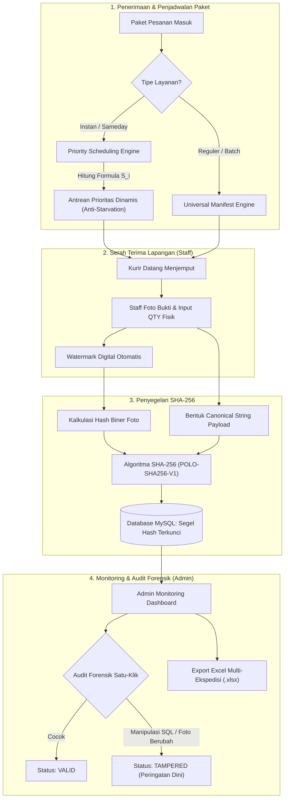

<div align="center">

# 📦 POLO PICKUP PAKET & LOGISTICS SYSTEM
### Sistem Manajemen Serah Terima Logistik & Antrean Kurir Ekspedisi Berbasis Algoritma *Priority Scheduling* (Non-Preemptive + *Dynamic Aging*) dan Integritas Kriptografis SHA-256
**PT. POLO SPORT INDONESIA &bull; TUGAS AKHIR / SKRIPSI TEKNIK INFORMATIKA**

[](https://php.net)
[](https://mysql.com)
[](#-integritas-kriptografis-sha-256)
[](#-algoritma-priority-scheduling--dynamic-aging)
[](https://getbootstrap.com)
[](LICENSE)

---

</div>

## 📑 Daftar Isi
- [Ringkasan Proyek](#-ringkasan-proyek)
- [Masalah & Solusi Inovatif](#-masalah--solusi-inovatif)
- [Fitur Utama Sistem](#-fitur-utama-sistem)
  - [1. Algoritma Priority Scheduling & Dynamic Aging](#1-algoritma-priority-scheduling--dynamic-aging)
  - [2. Integritas Kriptografis SHA-256 & Audit Forensik](#2-integritas-kriptografis-sha-256--audit-forensik)
  - [3. Engine Manifest Multi-Ekspedisi Universal](#3-engine-manifest-multi-ekspedisi-universal)
  - [4. Pemisahan Peran Ketat (Role-Based Access Control)](#4-pemisahan-peran-ketat-role-based-access-control)
- [Diagram Arsitektur & Alur Kerja](#-diagram-arsitektur--alur-kerja)
- [Teknologi yang Digunakan](#-teknologi-yang-digunakan)
- [Panduan Instalasi & Menjalankan](#-panduan-instalasi--menjalankan)
- [Akun Pengguna Default](#-akun-pengguna-default)
- [Pengujian Otomatis & Tolok Ukur Eksperimen](#-pengujian-otomatis--tolok-ukur-eksperimen)
- [Struktur Direktori Proyek](#-struktur-direktori-proyek)
- [Atribusi Akademik & Pengembang](#-atribusi-akademik--pengembang)

---

## 🌟 Ringkasan Proyek

**Polo Pickup Paket System** adalah platform web terpadu yang dirancang untuk mengelola proses serah terima barang (*pickup*) dari gudang distribusi **PT. Polo Sport Indonesia** kepada berbagai mitra logistik (Shopee Xpress, Lazada Express, JNE, J&T Express, ID Express, Ninja Xpress, SiCepat, dan Kurir Instan/Sameday).

Sistem ini dikembangkan secara spesifik untuk memecahkan dua tantangan krusial dalam operasional *supply chain*:
1. **Ketidaktepatan Urutan Penanganan Paket Kurir Instan/Sameday**: Keterlambatan waktu serah terima akibat antrean konvensional (FIFO) yang mengabaikan *Service Level Agreement* (SLA) dan jam *cut-off* kurir.
2. **Ketiadaan Validasi Integritas Data Serah Terima Fisik**: Risiko manipulasi kuantitas (QTY), pergantian foto bukti, atau penghapusan nomor resi tanpa jejak audit digital.

---

## 💡 Masalah & Solusi Inovatif

| Aspek Operasional | Sistem Konvensional (Sebelumnya) | Solusi Inovatif Sistem Ini |
| :--- | :--- | :--- |
| **Penjadwalan Antrean** | Antrean acak / First-In First-Out (FIFO) yang rentan *breach* SLA kurir instan. | **Non-Preemptive Priority Scheduling** dengan kompensasi **Dynamic Aging** multi-kriteria ($S_i$). |
| **Keaslian Bukti Serah Terima** | Foto fisik disimpan biasa di direktori publik; rentan modifikasi biner atau manipulasi SQL. | **Penyegelan Ganda Kriptografi SHA-256** (*Canonical Payload Hash* + *Binary File Hash*). |
| **Integritas Manifest Ekspedisi** | File Excel diupload tanpa validasi agregat; resi bisa disunting tanpa ketahuan. | **Aggregate Manifest Hash** (Merkle-tree equivalent) yang mendeteksi perubahan data hingga level 1 resi. |
| **Pemisahan Peran (RBAC)** | Admin dan Staff memiliki akses yang tumpang-tindih. | **Pemisahan Peran Ketat**: Admin khusus monitoring & audit forensik; Staff khusus operasional fisik lapangan. |
| **Laporan & Rekonsiliasi** | Ekspor terpisah-pisah dan tidak terstandarisasi. | **Export Laporan OpenXML (.xlsx)** terpadu 8 ekspedisi dengan segel digital kriptografi. |

---

## 🚀 Fitur Utama Sistem

### 1. Algoritma Priority Scheduling & Dynamic Aging
Sistem menghitung skor prioritas dinamis secara otomatis untuk setiap paket instan/sameday dengan formula multi-kriteria:

$$\Large S_i = (C_i \times 0.40) + (T_i \times 0.35) + (V_i \times 0.15) + A_i$$

**Parameter Pembobotan:**
- **$C_i$ (Bobot SLA Layanan - 40%)**: `INSTANT / SAMEDAY` = 100, `EXPRESS` = 75, `REGULER` = 50, `CARGO` = 25.
- **$T_i$ (Urgensi Waktu Cut-Off - 35%)**: Dihitung dari sisa menit menuju batas penjemputan ($<30\text{ mnt} \rightarrow 100$, $<60\text{ mnt} \rightarrow 80$, $<120\text{ mnt} \rightarrow 50$, $\ge 120\text{ mnt} \rightarrow 20$).
- **$V_i$ (Skala Volume Batch - 15%)**: Skala paket per pemesanan ($1\text{ pkt} \rightarrow 40$, $2\text{--}5\text{ pkt} \rightarrow 60$, $\ge 6\text{ pkt} \rightarrow 80$).
- **$A_i$ (Kompensasi Dynamic Aging - Eliminasi Starvation)**: Penambahan skor secara otomatis sebesar $+0.25$ poin per menit tunggu, memastikan paket volume kecil yang datang lebih awal tidak pernah mengalami *starvation* (ditinggalkan tanpa batas).

### 2. Integritas Kriptografis SHA-256 & Audit Forensik
- **Dual-Layer Digital Seal**: Mengombinasikan data identitas kurir, tanggal serah terima, QTY fisik, dan *raw binary hash* foto bukti penjemputan.
- **Audit Forensik Satu-Klik**: Admin dapat memverifikasi keaslian rekaman dengan tombol audit. Sistem akan menghitung ulang biner berkas dan *canonical string*, lalu mengidentifikasi status:
  - 🟢 **VALID**: Rekaman dan berkas fisik 100% identik dengan kondisi saat serah terima.
  - 🔴 **TAMPERED**: Terdeteksi manipulasi pada database SQL atau foto fisik telah diubah (walaupun hanya berbeda 1-bit).
  - 🟡 **FILE_MISSING**: Berkas fisik foto sengaja atau tidak sengaja terhapus dari server.
  - ⚪ **LEGACY**: Kompatibilitas mundur untuk rekaman historis pra-implementasi skripsi.

### 3. Engine Manifest Multi-Ekspedisi Universal
- Mendukung integrasi 8 ekspedisi besar di Indonesia:
  1. **INSTAN / SAMEDAY** (Antrean Prioritas & Bukti Foto Kurir)
  2. **SPX** (Shopee Xpress)
  3. **LEX** (Lazada Express)
  4. **JNE Express**
  5. **J&T Express**
  6. **ID Express**
  7. **Ninja Xpress**
  8. **SiCepat Ekspres**
- **Modal Export Excel Multi-Ekspedisi**: Filter berdasarkan ekspedisi, file batch manifest, dan rentang tanggal (Hari Ini, 7 Hari, Bulan Ini, Semua). Menghasilkan berkas OpenXML (`.xlsx`) berstempel *SHA-256 Hash Aggregate*.
- **Auto-Sync Target QTY**: Kuantitas sah dari hasil import manifest Excel langsung terhubung otomatis ke batas validasi serah terima foto fisik.

### 4. Pemisahan Peran Ketat (Role-Based Access Control)
- **Role Admin (`adminpolo`)**:
  - Dashboard eksekutif, grafik volume, komposisi kurir, dan monitoring SLA.
  - Pusat Import & Export berkas manifest Excel.
  - Audit forensik kriptografi SHA-256 dan log integritas.
  - Dilarang keras mengambil foto atau upload manual (menjaga independensi pengawasan).
- **Role Staff (`rafli`)**:
  - Halaman antrean penanganan paket operasional.
  - Kamera HTML5 real-time dengan auto-watermark stempel tanggal, nama kurir, dan identitas perusahaan.
  - Input jumlah paket fisik dengan validasi anti-selisih terhadap target manifest admin.

---

## 📐 Diagram Arsitektur & Alur Kerja



---

## 🛠 Teknologi yang Digunakan

| Komponen | Teknologi | Keterangan |
| :--- | :--- | :--- |
| **Backend Core** | PHP 8.3 Native OOP | Arsitektur MVC (*Model-View-Controller*), Service Layer, Router Modular |
| **Database** | MySQL 8.4 / MariaDB 11.x | InnoDB Engine, Foreign Key Constraints, B-Tree Indexes |
| **Keamanan** | SHA-256, Bcrypt, CSRF Protection | Hashing kriptografi dua lapis, session hardening, sanitasi input XSS |
| **Frontend UI** | Bootstrap 5, Modern CSS | Desain responsif, Lucide Icons, Animate.css, SweetAlert2 |
| **Spreadsheet Engine** | OpenXML Generator Native | Standar komputasi industri tanpa ketergantungan library berat |
| **Kamera & Grafis** | HTML5 Canvas API & WebRTC | Pengambilan foto langsung dari kamera HP/laptop dengan watermark otomatis |

---

## 💻 Panduan Instalasi & Menjalankan

### 1. Prasyarat Sistem
- **Web Server**: Apache 2.4+ atau Nginx (disarankan menggunakan [Laragon](https://laragon.org/) di Windows).
- **PHP**: Versi 8.2 atau 8.3 dengan ekstensi aktif: `pdo_mysql`, `gd`, `openssl`, `mbstring`, `zip`.
- **Database**: MySQL 8.0+ atau MariaDB 10.6+.

### 2. Kloning Repositori
```bash
git clone https://github.com/thioharifaisyi28-hub/pickup-paket.git
cd pickup-paket
```

### 3. Konfigurasi Lingkungan (*Environment*)
Salin berkas contoh konfigurasi `.env.example` ke dalam folder `secure_app/.env`:
```bash
cp secure_app/.env.example secure_app/.env
```
Sesuaikan parameter koneksi database Anda di `secure_app/.env`:
```env
DB_HOST=127.0.0.1
DB_PORT=3306
DB_DATABASE=pickup_skripsi_db
DB_USERNAME=root
DB_PASSWORD=

APP_URL=http://localhost/pickup-paket/public_html
```

### 4. Import Basis Data
1. Buat database baru bernama `pickup_skripsi_db` di phpMyAdmin / MySQL CLI:
   ```sql
   CREATE DATABASE pickup_skripsi_db CHARACTER SET utf8mb4 COLLATE utf8mb4_unicode_ci;
   ```
2. Import berkas skema dan data awal:
   ```bash
   mysql -u root -p pickup_skripsi_db < pickup_skripsi_db.sql
   mysql -u root -p pickup_skripsi_db < secure_app/storage/migrations/001_skripsi_priority_and_sha256.sql
   ```

### 5. Menjalankan Aplikasi
- **Menggunakan Laragon**: Letakkan repositori di `C:\laragon\www\pickup-paket`, nyalakan layanan Apache & MySQL, lalu buka `http://localhost/pickup-paket/public_html` di peramban.
- **Menggunakan PHP Built-in Server**:
  ```bash
  php -S localhost:8000 -t public_html
  ```
  Akses aplikasi pada peramban melalui alamat: `http://localhost:8000`.

---

## 🔑 Akun Pengguna Default

| Role | Username | Password Default | Hak Akses Utama |
| :--- | :--- | :--- | :--- |
| **Administrator** | `adminpolo` | *Sesuai kredensial seed* | Monitoring, Audit Forensik SHA-256, Export/Import Excel |
| **Staff Gudang** | `rafli` | *Sesuai kredensial seed* | Input Antrean Paket, Ambil Foto Fisik Kamera, Serah Terima |

---

## 🧪 Pengujian Otomatis & Tolok Ukur Eksperimen

Sistem dilengkapi rangkaian pengujian otomatis (*automated test suites*) komprehensif untuk pengujian skripsi:

```bash
# 1. Jalankan seluruh eksperimen skripsi (Whitebox, Forensik SHA-256, Benchmark, Blackbox)
php secure_app/storage/tests/run_skripsi_experiments.php

# 2. Uji verifikasi fitur Export Excel Multi-Ekspedisi
php secure_app/storage/tests/test_multi_expedition_export.php

# 3. Uji pemisahan hak akses peran (Admin vs Staff)
php secure_app/storage/tests/test_role_separation_ekspedisi.php

# 4. Uji koneksi manifest target hasil ekspedisi
php secure_app/storage/tests/test_ekspedisi_manifest_connection.php

# 5. Uji penyatuan antrean Instan & Sameday
php secure_app/storage/tests/test_unify_instant_sameday.php
```

### Hasil Tolok Ukur Pengujian (*Benchmark Summary*):
- **Eksperimen 1 (Whitebox Priority Scheduling)**: Akurasi perhitungan skor 100% presisi identik dengan kalkulasi matematis manual.
- **Eksperimen 2 (Dynamic Aging Progression)**: Peningkatan skor linear terbukti mengeliminasi *starvation* pada paket tertunda.
- **Eksperimen 3 (Deteksi Forensik Manipulasi SHA-256)**: 100% sukses mendeteksi manipulasi SQL kurir, perubahan biner foto 1-bit, penghapusan resi manifest, dan kehilangan berkas fisik.
- **Eksperimen 4 (Benchmark Scaling)**: Rekalkulasi skor untuk 1.000 paket selesai dalam waktu `<910 ms`, dan query antrean terindeks dieksekusi dalam `<3.7 ms`.
- **Eksperimen 5 (Blackbox Testing)**: 12 skenario pengujian fungsional lulus 100% (*ALL PASSED*).

---

## 📂 Struktur Direktori Proyek

```plaintext
pickup-paket/
├── .env.example                     # Contoh konfigurasi lingkungan publik
├── .gitignore                       # Proteksi berkas privat, cache & uploads
├── README.md                        # Dokumentasi komprehensif proyek
├── index.php                        # Root router pengarah ke public_html
├── pickup_skripsi_db.sql            # Dump basis data awal
├── public_html/                     # Document root publik web server
│   ├── .htaccess                    # URL Rewriting & proteksi berkas
│   ├── index.php                    # Front controller utama aplikasi
│   ├── assets/                      # Berkas statis CSS, JS, font, gambar
│   └── storage/                     # Symlink/target berkas publik terpilih (.gitkeep)
└── secure_app/                      # Logika aplikasi inti (di luar jangkauan langsung web)
    ├── .env                         # Konfigurasi privat lokal (diabaikan git)
    ├── app/
    │   ├── Controllers/             # Controller logika antarmuka & alur
    │   ├── Models/                  # Model query basis data (ActiveRecord/DAO)
    │   └── Services/                # Service Layer (Priority Scheduling & SHA-256)
    ├── config/                      # Konfigurasi aplikasi & database
    ├── core/                        # Engine framework (App, Controller, Model, DB)
    ├── resources/views/             # Template tampilan antarmuka (Views)
    ├── routes/                      # Peta routing web (web.php)
    └── storage/                     # Penyimpanan internal, migrasi & pengujian
        ├── migrations/              # Berkas migrasi database skripsi
        └── tests/                   # Berkas skrip pengujian otomatis (PHP CLI)
```

---

## 👨‍💻 Atribusi Akademik & Pengembang

- **Peneliti / Pengembang**: Rafli Thio Al Harifaisyi
- **Program Studi**: Teknik Informatika (S-1)
- **Fakultas**: Fakultas Ilmu Komputer
- **Perguruan Tinggi**: Universitas Pamulang (UNPAM)
- **Mitra Studi Kasus**: PT. Polo Sport Indonesia

---

<div align="center">
  <sub>Dikembangkan dengan penuh dedikasi untuk kemajuan teknologi rantai pasok dan keamanan informasi digital di Indonesia.</sub>
</div>
